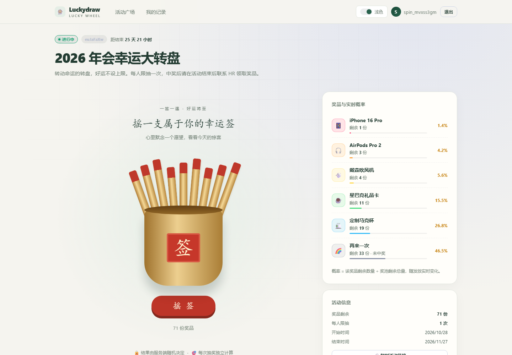
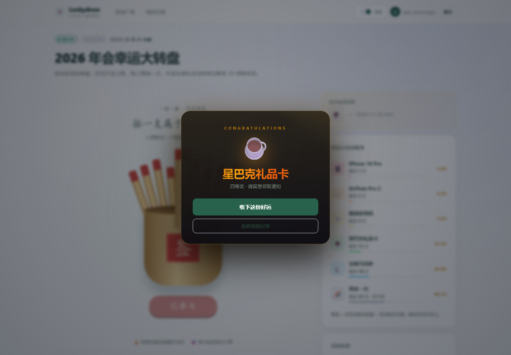
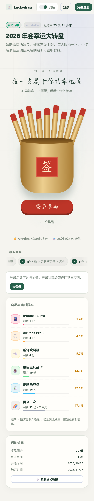
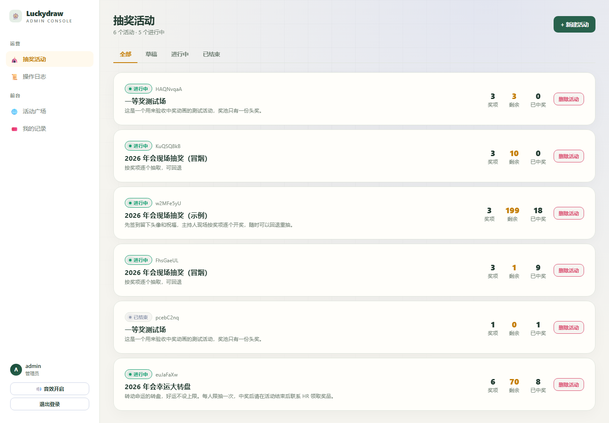
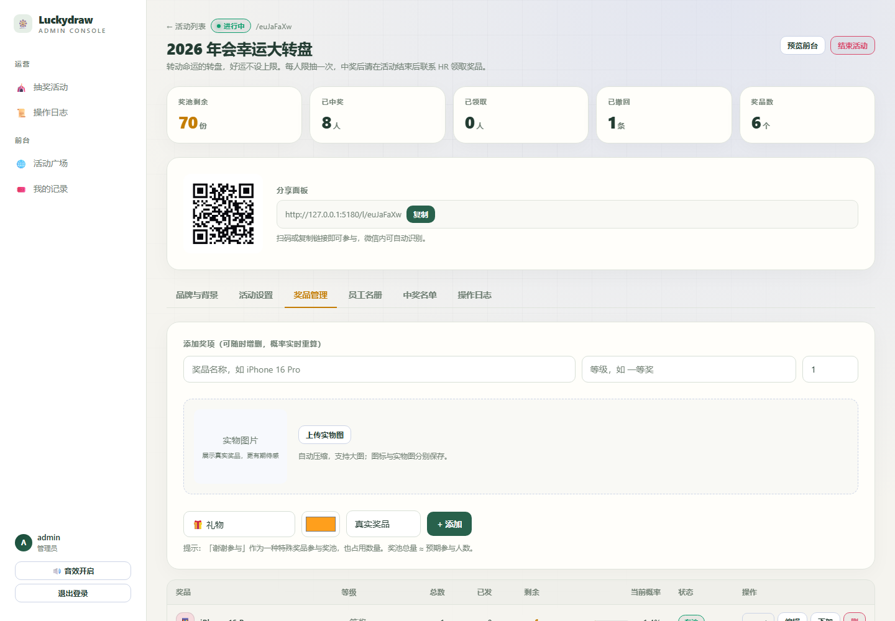
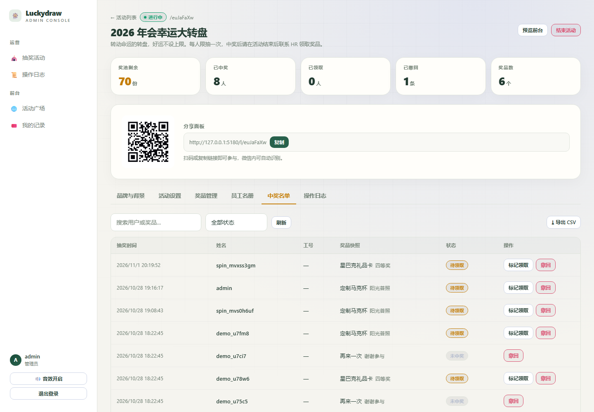
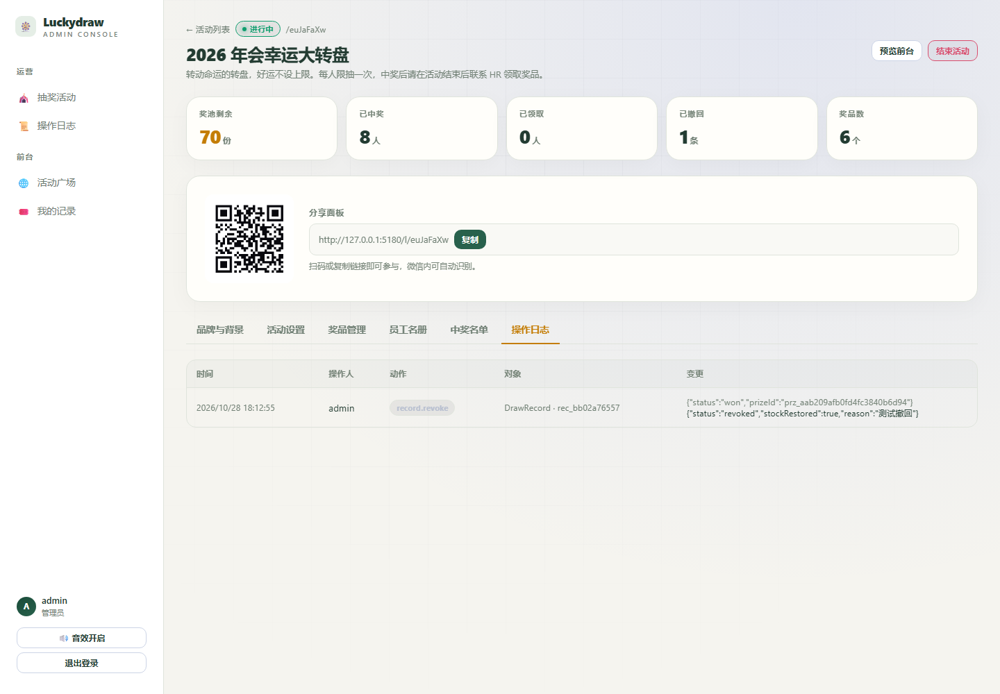
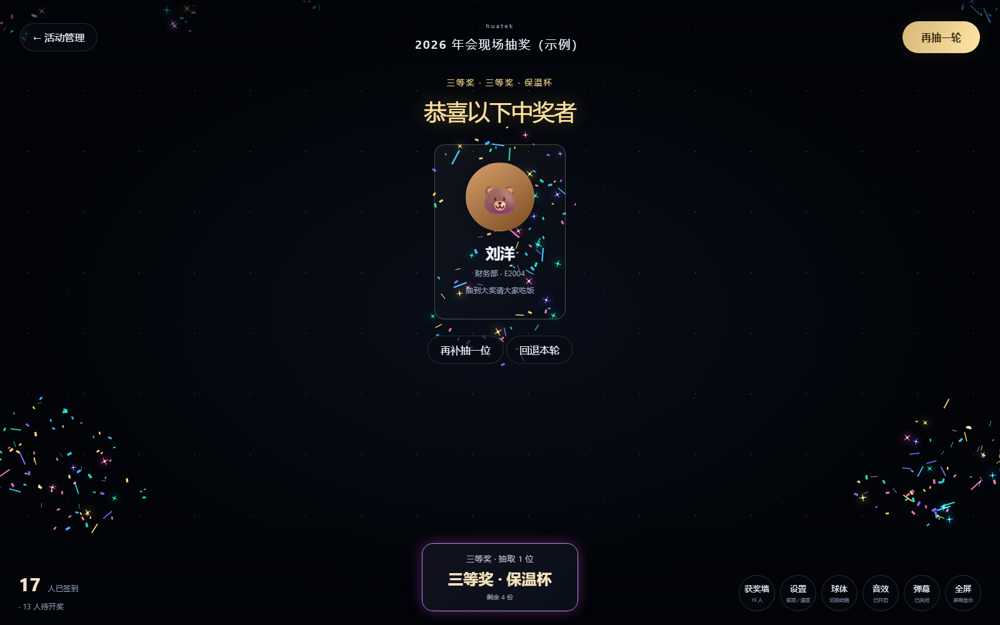

# Luckydraw · B/S 抽奖系统

按剩余库存实时算概率的转盘抽奖系统：每人一次、事务安全发奖、管理员可撤回重抽。
前端 Vite + React，后端 Node + Express，数据层用 Node 内置 `node:sqlite`（零原生编译、零额外服务）。

## 快速开始

需要 Node.js >= 22.5.0。Node 22.11.0 等早期版本需启用 --experimental-sqlite；项目的 dev、start、seed、test 脚本已包含该参数。直接运行后端时请使用 
ode --experimental-sqlite server/src/index.js。


```bash
npm install          # 安装依赖（workspaces）
npm run seed         # 初始化数据库 + 默认账号 + 示例活动
npm run dev          # 同时启动后端(4000) 和前端(5173)
```

打开 http://127.0.0.1:5173 即可。

默认账号（可由环境变量覆盖）：

| 角色 | 账号 | 密码 |
| --- | --- | --- |
| 管理员 | `admin` | `admin123` |
| 普通用户 | `demo` | `demo123` |

示例活动分享码：`euJaFaXw` → http://127.0.0.1:5173/l/euJaFaXw

## 生产部署

```bash
npm run build        # 构建前端到 web/dist
NODE_ENV=production npm start
```

`web/dist` 存在时由 Node 直接托管（单端口 4000），无需额外 Nginx。

```bash
docker build -t luckydraw .
docker run -p 4000:4000 -e JWT_SECRET=xxx -v $PWD/data:/app/server/data luckydraw
```

## 环境变量

见 `.env.example`，放到 `server/.env` 或直接注入容器环境。

## 核心设计

- **概率不落库**：`P(奖品i) = remaining_i / Σremaining`，每次请求实时计算，转盘扇区角度也按此分配（视觉即概率）。
- **不超发**：扣库存用条件更新 `UPDATE Prize SET remaining = remaining - 1 WHERE id = ? AND remaining > 0 AND status = 'active'`，影响行数为 0 就重选，最多重试 5 次。选号用 `crypto.randomInt`。
- **每人一次**：`Participation(lotteryId, userId)` 唯一索引 + `currentRecordId`；撤回时置 null，用户即可重抽。
- **历史不可变**：`DrawRecord` 冗余 `prizeNameSnapshot` / `prizeLevelSnapshot`，之后改名、下架、删除都不影响历史。
- **可追溯**：`AdminOperationLog` 记录操作人、动作与 before/after。
- **幂等**：`POST /draw` 支持 `Idempotency-Key`，双击或多标签页只产生一条有效记录。
- **结果只由服务端决定**：前端动画只负责把转盘停到服务端返回的那个扇区（调试钩子 `window.__wheel` 可验证落点）。

## 接口一览

| 方法 | 路径 | 说明 |
| --- | --- | --- |
| POST | `/api/auth/register` `/api/auth/login` | 注册 / 登录 |
| GET | `/api/auth/me` | 当前用户 |
| GET | `/api/lotteries` | 进行中的活动 |
| GET | `/api/lotteries/share/:shareCode` | 分享码取活动（公开） |
| POST | `/api/lotteries/:id/draw` | 抽奖（需登录，支持 Idempotency-Key） |
| GET | `/api/lotteries/:id/my-result` | 我的结果 / 是否被撤回 |
| GET | `/api/me/records` | 我的全部记录 |
| POST | `/api/admin/lotteries` | 建活动 |
| POST | `/api/admin/lotteries/:id/publish` `/end` | 发布 / 结束 |
| GET | `/api/admin/lotteries/:id/stats` | 奖品总数/已发/剩余/实时概率 |
| POST/PATCH/DELETE | `/api/admin/lotteries/:id/prizes` `/api/admin/prizes/:id` | 奖品增改删、上下架 |
| GET | `/api/admin/lotteries/:id/records` | 中奖名单 |
| POST | `/api/admin/records/:id/revoke` | 撤回（退库存、释放参与位） |
| POST | `/api/admin/records/:id/claim` | 标记已领取 |
| GET | `/api/admin/logs` | 操作日志 |

## 测试

```bash
npm test             # 15 个用例：概率分布、50 人抢 10 份不超发、幂等、撤回重抽、边界校验
```

## 视觉与交互

- Canvas 转盘：扇区按剩余数量分配、旋转时按角速度做动态模糊、光点追逐、指针回弹、落点精确对齐结果扇区。
- 中奖弹窗 + 礼花粒子 + 音效（可静音），`最近中奖` 滚动播报。
- 移动端完整适配（≤640px 单列布局，转盘自适应缩放）。

## 界面预览

> 截图基于当前线上界面（暗色主题）。用户端为「幸运签」抽奖体验；管理端覆盖活动与奖品管理、中奖名单、操作日志，以及年会现场开奖台。

### 用户端

| 活动抽奖页 | 中奖结果弹窗 |
| --- | --- |
|  |  |

- **活动抽奖页**：右侧实时概率侧栏按剩余库存展示各奖品中奖率，点击「摇签」即由服务端决定结果。
- **中奖结果弹窗**：展示奖品名称、等级与领取提示。



- **移动端适配**：窄屏单列布局，签筒与信息自适应缩放，无横向溢出。

### 管理端

| 活动列表 | 活动详情 / 奖品管理 |
| --- | --- |
|  |  |

| 中奖名单 | 操作日志 |
| --- | --- |
|  |  |

- **活动列表 / 详情 / 奖品管理**：创建活动，增改删奖品，发布与结束，查看实时概率与统计。
- **中奖名单**：记录每位中奖者、奖品等级与撤回状态，支持导出 CSV。
- **操作日志**：建活动、开奖、撤回等操作全程留痕，可追溯。

### 年会现场开奖台



- **现场开奖台**：签到头像汇聚成星河，按奖项逐轮开奖，支持中奖墙、补抽与回退本轮。

## 目录

```
server/        Express API + node:sqlite + 抽奖事务
  src/services/draw.js   抽奖/撤回/统计核心
  test/draw.test.js      逻辑与并发测试
web/           React 前端（用户端 + /admin 后台）
  src/components/Wheel.jsx   Canvas 转盘动画
scripts/       无头浏览器验证脚本（截图、点击抽奖、落点校验）
```

